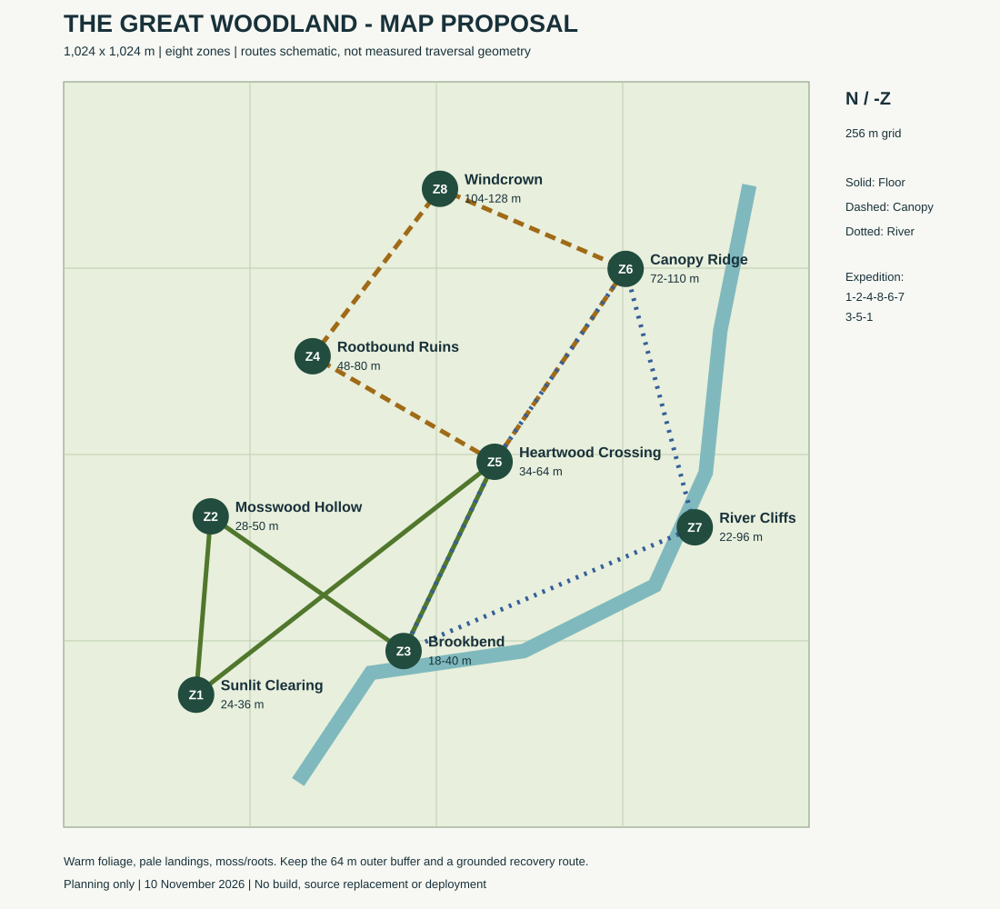

# Great Woodland map proposal

10 November 2026. **Planning only: not an implemented map or a release.**

- [Full map and phased build plan](GREAT-WOODLAND-MAP-PLAN-20261110.md)
- [72-item asset-family register](ASSET-REGISTER-20261110.json)
- [Editable world, zone and route data](MAP-DATA-20261110.json)
- [Editable map diagram](GREAT-WOODLAND-MAP-20261110.svg)
- [File integrity manifest](MANIFEST.json)

The proposal is a connected 1,024 × 1,024 m woodland: eight zones, three circuits and a longer expedition. Dimensions, counts and budgets remain estimates. Start with a representative 160 m pilot rather than dressing the entire world. Terrain3D Web support is experimental; keep the baked terrain fallback.

The plan preserves the existing flight feel and requires explicit new map bounds, ordered route/checkpoints and recovery behavior. It references the separate solo-finish branch at ba8e8a6915dbcfbb103879e645b3f1a861cc9085; it does not merge that branch or silently update the main runtime.

Only project-authored planning text, structured data and diagram are included. No third-party asset binaries, reference pack, private links, credentials or personal computer paths are published. Tool and asset recommendations do not imply installation, licensing clearance for every media file or browser validation. Project files retain their existing rights; no new licence is granted.
